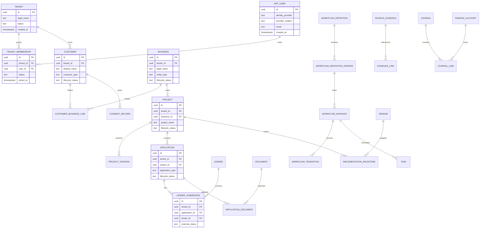

# ALGORITHM — Column-Level Data Dictionary & ERD V2

**Status:** Proposed logical/physical design draft. Not executable migration DDL. Types are PostgreSQL-oriented proposals and require review against the selected runtime and legal requirements.

**Architecture baseline:** DB01–DB33 numbering is preserved. This revision elaborates the identity, tenancy, customer/business/project/application, workflow, document, evidence, consent and ledger foundations. Unresolved ownership decisions remain blockers; no table is declared production-ready.

## 1. Conventions

- PostgreSQL types: `UUID`, `TEXT`, `BOOLEAN`, `DATE`, `TIMESTAMPTZ`, `JSONB`, `BIGINT`, `NUMERIC(19,4)`.
- PKs use UUID. Generate UUIDs in the trusted application/database layer.
- Tenant-owned rows carry `tenant_id UUID NOT NULL`; global identity and global reference catalogues are explicitly marked.
- Timestamps are UTC. Monetary amounts use fixed precision and an ISO 4217 currency code.
- `created_at` and `updated_at` are NOT NULL. Actor columns may be nullable for trusted system-originated events but must record a system actor/source.
- Statuses are controlled reference values or constrained enums; external statuses are preserved separately.
- FK actions default to RESTRICT/NO ACTION. Cascading hard deletes are prohibited for business/audit records.
- `JSONB` is for bounded metadata/snapshots, not a substitute for relational keys or searchable core attributes.
- For composite tenant-safe FKs, referenced parent tables require a matching unique key such as `UNIQUE (tenant_id, id)`.

## 2. ERD V2 — logical relationship map

The diagram is a core relationship view, not a complete depiction of every DB01–DB33 table.

## 3. Column-level dictionary — foundation tables

### 3.1 DB32 — tenant, user and membership

#### `tenant` (global tenant root)
| Column | Type | Null | Key / rule | Meaning |
|---|---|---:|---|---|
| id | UUID | No | PK | Tenant identifier |
| legal_name | TEXT | No | | Registered/legal tenant name |
| display_name | TEXT | Yes | | UI display name |
| status | TEXT | No | CHECK: ACTIVE, SUSPENDED, CLOSED | Tenant lifecycle |
| default_currency | CHAR(3) | No | ISO 4217 validation | Default reporting currency |
| created_at | TIMESTAMPTZ | No | | Creation time |
| updated_at | TIMESTAMPTZ | No | | Last update |

#### `app_user` (global identity; no tenant_id)
| Column | Type | Null | Key / rule | Meaning |
|---|---|---:|---|---|
| id | UUID | No | PK | Internal user ID |
| identity_provider | TEXT | No | | Trusted IdP key |
| provider_subject | TEXT | No | UNIQUE(identity_provider, provider_subject) | Immutable IdP subject |
| email | TEXT | Yes | Not a login key by itself | Current email claim |
| email_verified | BOOLEAN | No | DEFAULT FALSE | Verified email claim |
| display_name | TEXT | Yes | | Display label |
| account_status | TEXT | No | CHECK: ACTIVE, DISABLED, LOCKED | Global account state |
| last_authenticated_at | TIMESTAMPTZ | Yes | | Last successful authentication |
| created_at | TIMESTAMPTZ | No | | Creation time |
| updated_at | TIMESTAMPTZ | No | | Last update |

#### `tenant_membership`
| Column | Type | Null | Key / rule | Meaning |
|---|---|---:|---|---|
| id | UUID | No | PK | Membership ID |
| tenant_id | UUID | No | FK tenant(id), UNIQUE(tenant_id,user_id) | Tenant |
| user_id | UUID | No | FK app_user(id) | User |
| status | TEXT | No | CHECK: INVITED, ACTIVE, SUSPENDED, REVOKED | Membership state |
| invited_by | UUID | Yes | FK app_user(id) | Inviter |
| joined_at | TIMESTAMPTZ | Yes | | Accepted invitation time |
| created_at | TIMESTAMPTZ | No | | Creation time |
| updated_at | TIMESTAMPTZ | No | | Last update |

**Note:** Role assignment tables (`role`, `permission`, `membership_role`) belong to DB32 and need a separately approved permission matrix. Do not infer a role design from UI labels.

### 3.2 DB01 — customer and lead

#### `customer_master`
| Column | Type | Null | Key / rule | Meaning |
|---|---|---:|---|---|
| id | UUID | No | PK; UNIQUE(tenant_id,id) | Canonical customer |
| tenant_id | UUID | No | FK tenant(id) | Owning tenant |
| customer_type | TEXT | No | CHECK: INDIVIDUAL, ORGANIZATION, OTHER | Customer category |
| display_name | TEXT | No | | Canonical display name |
| lifecycle_status | TEXT | No | Controlled values: ACTIVE, INACTIVE, RESTRICTED, MERGED_PENDING_REVIEW | Customer lifecycle |
| preferred_language | TEXT | Yes | | Communication preference |
| primary_contact_id | UUID | Yes | FK policy to be defined | Preferred contact pointer |
| source_system | TEXT | Yes | | Source provenance |
| source_record_id | TEXT | Yes | | Source row identifier |
| created_at | TIMESTAMPTZ | No | | Created time |
| created_by | UUID | Yes | FK app_user(id) | Actor |
| updated_at | TIMESTAMPTZ | No | | Updated time |
| updated_by | UUID | Yes | FK app_user(id) | Actor |
| record_version | BIGINT | No | DEFAULT 1, CHECK > 0 | Optimistic version |

#### `customer_identity`
| Column | Type | Null | Key / rule | Meaning |
|---|---|---:|---|---|
| id | UUID | No | PK | Identity attribute ID |
| tenant_id | UUID | No | FK tenant(id) | Tenant |
| customer_id | UUID | No | Composite FK (tenant_id, customer_id) → customer_master | Customer |
| identity_type | TEXT | No | Controlled type | E.g. phone/email/tax identifier |
| normalized_value | TEXT | No | Encrypted/tokenized as appropriate | Normalized matching value |
| display_value_masked | TEXT | Yes | | Masked presentation value |
| verification_status | TEXT | No | CHECK: UNVERIFIED, VERIFIED, REJECTED, EXPIRED | Verification |
| verified_at | TIMESTAMPTZ | Yes | | Verification time |
| valid_from | TIMESTAMPTZ | Yes | | Validity start |
| valid_to | TIMESTAMPTZ | Yes | CHECK valid_to > valid_from | Validity end |
| created_at | TIMESTAMPTZ | No | | Created time |

Do not add global UNIQUE(phone/email). Identity resolution requires an approved policy and human-reviewed merge workflow.

#### `lead`
| Column | Type | Null | Key / rule | Meaning |
|---|---|---:|---|---|
| id | UUID | No | PK; UNIQUE(tenant_id,id) | Lead ID |
| tenant_id | UUID | No | FK tenant(id) | Tenant |
| lead_source | TEXT | No | | Acquisition source |
| lead_status | TEXT | No | Controlled: NEW, CONTACTED, QUALIFIED, CONVERTED, ON_HOLD, CLOSED | Lead lifecycle |
| customer_id | UUID | Yes | Composite FK to customer_master | Linked customer after resolution |
| subject_name | TEXT | Yes | | Unverified lead name |
| contact_snapshot | JSONB | Yes | Restricted, minimal, consent-governed | Intake contact snapshot |
| consent_record_id | UUID | Yes | FK DB33 consent_record | Consent evidence |
| assigned_membership_id | UUID | Yes | FK tenant_membership(id), tenant checked | Assigned owner |
| captured_at | TIMESTAMPTZ | No | | Intake time |
| created_at | TIMESTAMPTZ | No | | Created time |
| updated_at | TIMESTAMPTZ | No | | Updated time |

### 3.3 DB02 — business

#### `business_master`
| Column | Type | Null | Key / rule | Meaning |
|---|---|---:|---|---|
| id | UUID | No | PK; UNIQUE(tenant_id,id) | Business ID |
| tenant_id | UUID | No | FK tenant(id) | Tenant |
| legal_name | TEXT | No | | Legal name |
| trade_name | TEXT | Yes | | Trading name |
| entity_type | TEXT | No | Controlled entity type | Proprietorship/company/etc. |
| registration_number | TEXT | Yes | Type/jurisdiction-aware uniqueness only | Registration reference |
| industry_code | TEXT | Yes | FK/reference DB03 | Industry classification |
| lifecycle_status | TEXT | No | CHECK: DRAFT, PROFILE_PENDING, VERIFIED, ACTIVE, INACTIVE | Business status |
| registered_country | CHAR(2) | Yes | ISO 3166-1 alpha-2 | Jurisdiction |
| registered_state_code | TEXT | Yes | | State code |
| source_system | TEXT | Yes | | Provenance |
| source_record_id | TEXT | Yes | | External identifier |
| created_at | TIMESTAMPTZ | No | | Created time |
| created_by | UUID | Yes | FK app_user(id) | Actor |
| updated_at | TIMESTAMPTZ | No | | Updated time |
| updated_by | UUID | Yes | FK app_user(id) | Actor |
| record_version | BIGINT | No | DEFAULT 1, CHECK > 0 | Version |

#### `customer_business_links`
| Column | Type | Null | Key / rule | Meaning |
|---|---|---:|---|---|
| id | UUID | No | PK | Link ID |
| tenant_id | UUID | No | FK tenant(id) | Tenant |
| customer_id | UUID | No | Composite FK customer_master | Customer |
| business_id | UUID | No | Composite FK business_master | Business |
| relationship_type | TEXT | No | Controlled type | Owner, promoter, contact, authorized representative, etc. |
| is_primary | BOOLEAN | No | DEFAULT FALSE | Primary relationship flag |
| verification_status | TEXT | No | CHECK: UNVERIFIED, VERIFIED, REJECTED | Verification |
| valid_from | DATE | Yes | | Relationship start |
| valid_to | DATE | Yes | CHECK valid_to >= valid_from | Relationship end |
| created_at | TIMESTAMPTZ | No | | Created time |
| created_by | UUID | Yes | FK app_user(id) | Actor |
| UNIQUE | — | — | (tenant_id, customer_id, business_id, relationship_type) | Prevent duplicate active relationship; partial uniqueness may be needed for history |

### 3.4 DB04 — project

#### `project_master`
| Column | Type | Null | Key / rule | Meaning |
|---|---|---:|---|---|
| id | UUID | No | PK; UNIQUE(tenant_id,id) | Project ID |
| tenant_id | UUID | No | FK tenant(id) | Tenant |
| business_id | UUID | No | Composite FK business_master | Owning business |
| project_code | TEXT | Yes | UNIQUE(tenant_id, project_code) when present | Tenant project reference |
| project_name | TEXT | No | | Project name |
| project_category | TEXT | Yes | Reference DB03/DB04 | Category |
| project_location | JSONB | Yes | Structured address/geography schema to be finalized | Location |
| lifecycle_status | TEXT | No | Controlled project state | Current state |
| current_version_id | UUID | Yes | FK project_version; deferred circular FK handling | Current approved version |
| created_at | TIMESTAMPTZ | No | | Created time |
| created_by | UUID | Yes | FK app_user(id) | Actor |
| updated_at | TIMESTAMPTZ | No | | Updated time |
| updated_by | UUID | Yes | FK app_user(id) | Actor |
| record_version | BIGINT | No | DEFAULT 1, CHECK > 0 | Version |

#### `project_version`
| Column | Type | Null | Key / rule | Meaning |
|---|---|---:|---|---|
| id | UUID | No | PK; UNIQUE(tenant_id,id) | Version ID |
| tenant_id | UUID | No | FK tenant(id) | Tenant |
| project_id | UUID | No | Composite FK project_master | Parent project |
| version_number | INTEGER | No | CHECK > 0; UNIQUE(tenant_id, project_id, version_number) | Sequential version |
| version_status | TEXT | No | DRAFT, IN_REVIEW, APPROVED, SUPERSEDED | Version state |
| project_snapshot | JSONB | No | Schema-versioned snapshot | Versioned project facts |
| assumptions | JSONB | Yes | | Assumptions |
| source_evidence_set_id | UUID | Yes | DB29 link design pending | Evidence set |
| created_at | TIMESTAMPTZ | No | | Created time |
| created_by | UUID | Yes | FK app_user(id) | Author |
| approved_at | TIMESTAMPTZ | Yes | | Approval time |
| approved_by | UUID | Yes | FK app_user(id) | Approver |

### 3.5 DB17 — application and lender submissions

#### `application_master`
| Column | Type | Null | Key / rule | Meaning |
|---|---|---:|---|---|
| id | UUID | No | PK; UNIQUE(tenant_id,id) | Application ID |
| tenant_id | UUID | No | FK tenant(id) | Tenant |
| project_id | UUID | No | Composite FK project_master | Parent project |
| application_reference | TEXT | Yes | UNIQUE(tenant_id, application_reference) when present | Internal reference |
| application_type | TEXT | No | Scheme/loan/service type catalogue | Application category |
| lifecycle_status | TEXT | No | Controlled internal state | Internal state |
| original_external_status | TEXT | Yes | | Original lender/portal status |
| status_mapping_version | TEXT | Yes | | Normalization mapping version |
| requested_amount | NUMERIC(19,4) | Yes | CHECK >= 0 | Requested amount |
| currency_code | CHAR(3) | Yes | ISO 4217 | Currency |
| submitted_at | TIMESTAMPTZ | Yes | | Submission time |
| closed_at | TIMESTAMPTZ | Yes | | Closure time |
| created_at | TIMESTAMPTZ | No | | Created time |
| created_by | UUID | Yes | FK app_user(id) | Actor |
| updated_at | TIMESTAMPTZ | No | | Updated time |
| updated_by | UUID | Yes | FK app_user(id) | Actor |
| record_version | BIGINT | No | DEFAULT 1, CHECK > 0 | Version |

#### `lender_submission`
| Column | Type | Null | Key / rule | Meaning |
|---|---|---:|---|---|
| id | UUID | No | PK; UNIQUE(tenant_id,id) | Submission ID |
| tenant_id | UUID | No | FK tenant(id) | Tenant |
| application_id | UUID | No | Composite FK application_master | Application |
| lender_id | UUID | No | FK DB08 lender_master | Lender |
| loan_product_version_id | UUID | Yes | FK DB10 product version | Product version used |
| lender_reference | TEXT | Yes | Scoped uniqueness by lender/tenant | External reference |
| internal_status | TEXT | No | PREPARED, SUBMITTED, ACKNOWLEDGED, UNDER_REVIEW, QUERY, SANCTIONED, DECLINED, WITHDRAWN | Internal state |
| external_status | TEXT | Yes | Preserve exact source status | External state |
| status_mapping_version | TEXT | Yes | | Mapping version |
| submitted_at | TIMESTAMPTZ | Yes | | Submission time |
| last_status_at | TIMESTAMPTZ | Yes | | Last external status time |
| created_at | TIMESTAMPTZ | No | | Created time |
| created_by | UUID | Yes | FK app_user(id) | Actor |
| updated_at | TIMESTAMPTZ | No | | Updated time |

**Rule:** An application may have multiple lender submissions. A lender response must not overwrite another lender's response or the application's full history.

### 3.6 DB07 — document metadata and attachment junction

#### `document_master`
| Column | Type | Null | Key / rule | Meaning |
|---|---|---:|---|---|
| id | UUID | No | PK; UNIQUE(tenant_id,id) | Document ID |
| tenant_id | UUID | No | FK tenant(id) | Tenant |
| document_type | TEXT | No | Controlled catalogue | Document type |
| original_filename | TEXT | Yes | Sanitized display metadata | Original name |
| media_type | TEXT | Yes | Allow-list validation | MIME type |
| byte_size | BIGINT | Yes | CHECK >= 0 | Size |
| storage_provider | TEXT | No | Approved private provider | Storage system |
| object_key | TEXT | No | Opaque private object key | Object reference |
| checksum_sha256 | CHAR(64) | Yes | Hex validation | Integrity checksum |
| classification | TEXT | No | PUBLIC, INTERNAL, CONFIDENTIAL, RESTRICTED | Access classification |
| malware_scan_status | TEXT | No | PENDING, CLEAN, REJECTED, ERROR | Scan result |
| created_at | TIMESTAMPTZ | No | | Created time |
| created_by | UUID | Yes | FK app_user(id) | Uploader |

#### `application_document`
| Column | Type | Null | Key / rule | Meaning |
|---|---|---:|---|---|
| id | UUID | No | PK | Attachment ID |
| tenant_id | UUID | No | FK tenant(id) | Tenant |
| application_id | UUID | No | Composite FK application_master | Application |
| document_id | UUID | No | Composite FK document_master | Document |
| document_version_id | UUID | Yes | FK document version | Exact file version |
| requirement_code | TEXT | Yes | DB14 requirement reference | Required document slot |
| review_status | TEXT | No | PENDING, ACCEPTED, REJECTED, REUPLOAD_REQUIRED | Review |
| reviewed_at | TIMESTAMPTZ | Yes | | Review time |
| reviewed_by | UUID | Yes | FK app_user(id) | Reviewer |
| created_at | TIMESTAMPTZ | No | | Attached time |

### 3.7 DB18 — workflow engine

#### `workflow_definition`
| Column | Type | Null | Key / rule | Meaning |
|---|---|---:|---|---|
| id | UUID | No | PK | Workflow type |
| tenant_id | UUID | Yes | NULL means centrally managed template; access policy required | Tenant scope |
| workflow_key | TEXT | No | Unique within owner scope | Stable key |
| display_name | TEXT | No | | Name |
| aggregate_type | TEXT | No | Controlled aggregate name | Target entity |
| lifecycle_status | TEXT | No | DRAFT, ACTIVE, RETIRED | Definition state |
| created_at | TIMESTAMPTZ | No | | Created time |
| created_by | UUID | Yes | | Author |

#### `workflow_definition_version`
| Column | Type | Null | Key / rule | Meaning |
|---|---|---:|---|---|
| id | UUID | No | PK | Definition version |
| workflow_definition_id | UUID | No | FK workflow_definition | Parent |
| version_number | INTEGER | No | CHECK > 0; UNIQUE(workflow_definition_id, version_number) | Version |
| definition_json | JSONB | No | Validated against schema version | States/transitions/guards |
| schema_version | TEXT | No | | Definition schema |
| published_at | TIMESTAMPTZ | Yes | | Publish time |
| published_by | UUID | Yes | FK app_user(id) | Publisher |
| checksum_sha256 | CHAR(64) | No | | Immutable content checksum |

#### `workflow_instance`
| Column | Type | Null | Key / rule | Meaning |
|---|---|---:|---|---|
| id | UUID | No | PK; UNIQUE(tenant_id,id) | Instance |
| tenant_id | UUID | No | FK tenant(id) | Tenant |
| definition_version_id | UUID | No | FK workflow_definition_version | Pinned version |
| aggregate_type | TEXT | No | | Entity type |
| aggregate_id | UUID | No | Application-level/typed FK enforcement required | Target entity |
| current_state | TEXT | No | Must exist in pinned definition | Current state |
| instance_status | TEXT | No | ACTIVE, PAUSED, COMPLETED, CANCELLED, FAILED | Instance state |
| started_at | TIMESTAMPTZ | No | | Start |
| completed_at | TIMESTAMPTZ | Yes | | Completion |
| correlation_id | UUID | No | Indexed | End-to-end trace |

#### `workflow_transition`
| Column | Type | Null | Key / rule | Meaning |
|---|---|---:|---|---|
| id | UUID | No | PK | Transition event |
| tenant_id | UUID | No | FK tenant(id) | Tenant |
| workflow_instance_id | UUID | No | Composite FK workflow_instance | Instance |
| from_state | TEXT | No | | Previous state |
| to_state | TEXT | No | | New state |
| actor_user_id | UUID | Yes | FK app_user(id); system actor separately identified | Actor |
| actor_type | TEXT | No | USER, SYSTEM, INTEGRATION | Actor class |
| reason | TEXT | Yes | | Transition reason |
| source | TEXT | No | | Source system/action |
| idempotency_key | TEXT | No | UNIQUE(tenant_id,idempotency_key) | Duplicate prevention |
| occurred_at | TIMESTAMPTZ | No | | Event time |
| correlation_id | UUID | No | | Trace |

#### `task`
| Column | Type | Null | Key / rule | Meaning |
|---|---|---:|---|---|
| id | UUID | No | PK; UNIQUE(tenant_id,id) | Task |
| tenant_id | UUID | No | FK tenant(id) | Tenant |
| workflow_instance_id | UUID | No | Composite FK workflow_instance | Workflow |
| task_type | TEXT | No | | Task kind |
| title | TEXT | No | | Short title |
| task_status | TEXT | No | OPEN, IN_PROGRESS, BLOCKED, COMPLETED, CANCELLED | State |
| priority | TEXT | No | LOW, NORMAL, HIGH, URGENT | Priority |
| assigned_membership_id | UUID | Yes | FK tenant_membership; same tenant | Owner |
| due_at | TIMESTAMPTZ | Yes | | SLA due time |
| completed_at | TIMESTAMPTZ | Yes | | Completion time |
| created_at | TIMESTAMPTZ | No | | Created time |

### 3.8 DB29 — source evidence

#### `source_registry`
| Column | Type | Null | Key / rule | Meaning |
|---|---|---:|---|---|
| id | UUID | No | PK | Source ID |
| source_type | TEXT | No | OFFICIAL, CUSTOMER_PROVIDED, INTERNAL, THIRD_PARTY | Source class |
| publisher | TEXT | Yes | | Issuer |
| canonical_uri | TEXT | Yes | | Canonical reference |
| title | TEXT | No | | Source title |
| published_at | TIMESTAMPTZ | Yes | | Publication date |
| retrieved_at | TIMESTAMPTZ | No | | Retrieval date |
| content_hash | CHAR(64) | Yes | | Content fingerprint |
| source_status | TEXT | No | ACTIVE, SUPERSEDED, WITHDRAWN, UNVERIFIED | Status |

#### `source_evidence`
| Column | Type | Null | Key / rule | Meaning |
|---|---|---:|---|---|
| id | UUID | No | PK | Evidence ID |
| tenant_id | UUID | Yes | NULL for shared non-customer source; access policy required | Tenant scope |
| source_registry_id | UUID | No | FK source_registry | Source |
| claim_key | TEXT | No | | Supported claim/rule |
| excerpt_reference | TEXT | Yes | Page/section/locator; avoid unnecessary copied content | Locator |
| verification_status | TEXT | No | UNVERIFIED, VERIFIED, REJECTED, EXPIRED | Verification |
| verified_at | TIMESTAMPTZ | Yes | | Verification time |
| verified_by | UUID | Yes | FK app_user(id) | Reviewer |
| effective_from | DATE | Yes | | Validity start |
| effective_to | DATE | Yes | CHECK >= effective_from | Validity end |
| created_at | TIMESTAMPTZ | No | | Created time |

Use an explicit `evidence_link` junction with `evidence_id`, `subject_type`, `subject_id`, `tenant_id`, `relationship` and created_at to link evidence to policies, applications, calculations or decisions. Subject references require controlled application-level validation or typed junction tables; do not rely on an unconstrained polymorphic FK.

### 3.9 DB33 — consent and privacy

#### `privacy_notice_version`
| Column | Type | Null | Key / rule | Meaning |
|---|---|---:|---|---|
| id | UUID | No | PK | Notice version |
| notice_key | TEXT | No | | Notice family |
| version_number | INTEGER | No | UNIQUE(notice_key,version_number) | Version |
| locale | TEXT | No | | Language |
| notice_uri | TEXT | Yes | Approved published notice | Notice location |
| content_hash | CHAR(64) | No | | Immutable notice hash |
| effective_from | TIMESTAMPTZ | No | | Effective time |
| effective_to | TIMESTAMPTZ | Yes | | End time |

#### `consent_record`
| Column | Type | Null | Key / rule | Meaning |
|---|---|---:|---|---|
| id | UUID | No | PK; UNIQUE(tenant_id,id) | Consent |
| tenant_id | UUID | No | FK tenant(id) | Tenant |
| customer_id | UUID | No | Composite FK customer_master | Data subject/customer |
| purpose_code | TEXT | No | Controlled purpose catalogue | Specific purpose |
| notice_version_id | UUID | No | FK privacy_notice_version | Notice accepted |
| consent_status | TEXT | No | GRANTED, DENIED, WITHDRAWN, EXPIRED | State |
| collection_channel | TEXT | No | | Web, paper, assisted, etc. |
| captured_at | TIMESTAMPTZ | No | | Capture time |
| captured_by | UUID | Yes | FK app_user(id) | Capturing actor |
| expires_at | TIMESTAMPTZ | Yes | | Expiry |
| withdrawal_at | TIMESTAMPTZ | Yes | | Withdrawal time |
| evidence_reference | TEXT | Yes | Restricted evidence reference | Proof locator |

Consent is purpose-specific. A single blanket consent must not be assumed to cover unrelated processing purposes.

### 3.10 DB25 — finance ledger

#### `finance_account`
| Column | Type | Null | Key / rule | Meaning |
|---|---|---:|---|---|
| id | UUID | No | PK; UNIQUE(tenant_id,id) | Account |
| tenant_id | UUID | No | FK tenant(id) | Tenant |
| account_code | TEXT | No | UNIQUE(tenant_id,account_code) | Chart code |
| account_name | TEXT | No | | Account label |
| account_type | TEXT | No | ASSET, LIABILITY, EQUITY, INCOME, EXPENSE | Classification |
| currency_code | CHAR(3) | No | ISO 4217 | Account currency |
| is_active | BOOLEAN | No | DEFAULT TRUE | Active flag |
| created_at | TIMESTAMPTZ | No | | Created time |

#### `journal`
| Column | Type | Null | Key / rule | Meaning |
|---|---|---:|---|---|
| id | UUID | No | PK; UNIQUE(tenant_id,id) | Journal |
| tenant_id | UUID | No | FK tenant(id) | Tenant |
| journal_number | TEXT | No | UNIQUE(tenant_id,journal_number) | Ledger reference |
| journal_date | DATE | No | | Accounting date |
| currency_code | CHAR(3) | No | ISO 4217 | Journal currency |
| journal_status | TEXT | No | DRAFT, POSTED, REVERSED | State |
| source_type | TEXT | Yes | | Source event type |
| source_id | UUID | Yes | Typed source mapping required | Source reference |
| idempotency_key | TEXT | No | UNIQUE(tenant_id,idempotency_key) | Duplicate posting prevention |
| posted_at | TIMESTAMPTZ | Yes | | Posting time |
| posted_by | UUID | Yes | FK app_user(id) | Posting actor |
| created_at | TIMESTAMPTZ | No | | Created time |

#### `journal_line`
| Column | Type | Null | Key / rule | Meaning |
|---|---|---:|---|---|
| id | UUID | No | PK | Line |
| tenant_id | UUID | No | FK tenant(id) | Tenant |
| journal_id | UUID | No | Composite FK journal | Journal |
| line_number | INTEGER | No | UNIQUE(journal_id,line_number) | Sequence |
| account_id | UUID | No | Composite FK finance_account | Account |
| debit_amount | NUMERIC(19,4) | No | CHECK >= 0 | Debit |
| credit_amount | NUMERIC(19,4) | No | CHECK >= 0 | Credit |
| currency_code | CHAR(3) | No | Must equal journal currency unless FX model approved | Currency |
| memo | TEXT | Yes | | Line description |
| created_at | TIMESTAMPTZ | No | | Created time |

**Posting invariant:** Each posted journal must contain at least two lines and total debit must equal total credit in the journal currency. Enforce in a controlled posting transaction/deferred constraint trigger. Prevent direct mutation of posted journals; correct via reversal and replacement.

## 4. Remaining domain table families — field-level expansion backlog

The following are logical table families already assigned in DB01–DB33. Their full column-level dictionaries are the next domain-specific design batches; do not create physical tables solely from these names.

| Domain | Additional tables to detail next |
|---|---|
| DB03 | industry_classification, industry_evidence |
| DB05 | financial_profile, financial_statement, financial_snapshot, financial_ratio |
| DB06 | credit_facility, credit_obligation, credit_snapshot |
| DB08–DB10 | lender_master, lender_identifier, bank_branch, branch_hierarchy, loan_product, loan_product_version |
| DB11–DB15 | lender_policy, lender_policy_version, policy_rule, policy_review, sanction_authority, authority_limit_version, scheme_master, scheme_guideline_version, scheme_requirement, scheme_application_mapping, lender_scheme_mapping |
| DB16 | service_case, service_engagement, service_deliverable |
| DB19 | bank_followup, bank_interaction, bank_query |
| DB20 | registration_master, registration_case, compliance_obligation, compliance_event — blocked by ownership decision |
| DB21 | implementation_plan, implementation_milestone, vendor_master |
| DB22–DB24 | communication_template, communication_message, delivery_event, partner_master, partner_agreement, referral, commission_rule_version, commission_accrual, commission_settlement |
| DB26–DB28 | vendor_marketplace_profile, marketplace_listing, listing_event, support_case, service_history, support_outcome, analytics_metric_definition, reporting_snapshot |
| DB30–DB31 | ai_model_version, ai_run, ai_recommendation, human_review, event_outbox, notification_delivery, automation_definition, automation_run |

## 5. Required indexes and uniqueness — initial candidates

1. Tenant-owned tables: unique `(tenant_id,id)` to support tenant-safe composite FKs.
2. `tenant_membership`: unique `(tenant_id,user_id)`; index `(user_id,status)`.
3. `customer_master`: index `(tenant_id,lifecycle_status)`; avoid speculative personal-data indexes.
4. `customer_identity`: index on `(tenant_id,identity_type)`; matching token index only after privacy/security approval.
5. `business_master`: index `(tenant_id,lifecycle_status)`; conditional unique project/business references where populated.
6. `project_master`: index `(tenant_id,business_id,lifecycle_status)`.
7. `application_master`: index `(tenant_id,project_id,lifecycle_status)`.
8. `lender_submission`: index `(tenant_id,application_id,internal_status)`; scoped lender-reference uniqueness after provider semantics confirmed.
9. `task`: index `(tenant_id,task_status,due_at)`, and `(assigned_membership_id,task_status)`.
10. `workflow_transition`: unique idempotency key; index `(workflow_instance_id,occurred_at)`.
11. `document_master`: index `(tenant_id,created_at)`; never index raw sensitive content.
12. `journal`: unique journal number and idempotency key; index `(tenant_id,journal_date,journal_status)`.
13. All indexes must be validated against real query plans and workload before production.

## 6. Cross-tenant integrity and RLS requirements

- Each tenant-owned parent exposes `UNIQUE(tenant_id,id)`.
- Child FKs reference `(tenant_id,parent_id)`, not only parent UUID.
- The authenticated server resolves membership; transaction-local tenant context is set only after verification.
- Enable and FORCE RLS where supported/appropriate on every tenant-owned table.
- Runtime role must not own protected tables and must not have BYPASSRLS.
- Test SELECT/INSERT/UPDATE/DELETE, search, exports, file retrieval and async jobs across two synthetic tenants.
- Global tables (IdP identity, global lender/industry/source catalogues) require explicit read/write policy and tenant-scoped association rules.
- Background workers must carry verified tenant context and idempotency keys; no unscoped tenant-wide jobs.

## 7. Open blockers before executable DDL

| Blocker | Why it matters | Safe interim treatment |
|---|---|---|
| DB16/DB17 product taxonomy discrepancy | Product navigation taxonomy may not equal DB ownership catalogue. | Preserve DB01–DB33 and record mapping separately. |
| DB20 registration FK ownership | Registration may attach to customer, business, project or multiple subjects. | Do not finalize registration FKs; design a reviewed typed-subject model. |
| DB21 vendor ↔ DB25 finance reconciliation | Vendor payables and historical balances need a single source of truth. | No parallel vendor/ledger masters; map legacy records first. |
| Identity resolution / merge policy | Wrong merges can corrupt customer history and consent. | No automatic destructive merge; queue human review. |
| Auth provider / membership / role matrix | Determines identity claims and tenant permissions. | Keep auth integration and production RLS migrations blocked. |
| Actual PostgreSQL target and retention policy | Affects extensions, backup, restore, residency and legal deletion. | Treat PG16 CI service as test-only, not production selection. |
| Financial multi-currency and FX policy | Determines journal balancing and conversion records. | Do not post cross-currency journals until FX design approved. |
| Data classification and retention schedule | Controls KYC/document handling and deletion. | Restrict sensitive records; no production data in test fixtures. |

## 8. Review and release gates

- **Review A:** confirm names, cardinalities and canonical ownership.
- **Review B:** resolve all blockers that affect FK structure.
- **Review C:** approve per-table classification, retention, consent and role access.
- **Review D:** create executable SQL migrations only after the target DB is inspected and a backup/restore test is evidenced.
- **Review E:** run staging migration, tenant-isolation tests, journal-balance tests, workflow transition tests and reconciliation before explicit production release approval.

**This file contains a proposed data dictionary and logical ERD only. It does not create tables, run migrations, provision PostgreSQL or change production data.**
