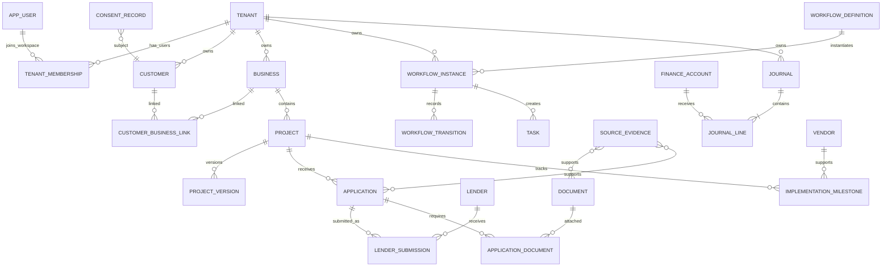

# ALGORITHM_DATABASE_ARCHITECTURE_V1

**Status:** Conceptual architecture proposal for review. This document is not executable DDL and does not represent a deployed database.

## 1. Design boundaries

- Preserve the approved DB01–DB33 domain catalogue and numbering.
- Keep one canonical customer linked to multiple businesses; each business may have multiple projects; each project may have multiple applications; each application may have multiple lender submissions.
- Use PostgreSQL as the proposed relational database baseline, subject to environment confirmation.
- Use UUID primary keys, UTC timestamps, explicit currency codes and fixed-precision numeric types for monetary values.
- **Single-tenant architecture:** ALGORITHM has one centrally managed organization workspace only. Multiple authorized users may access that same workspace; this is not a single-user design. Do not create customer-selectable tenants, tenant switching, or multiple independent organization workspaces.
- Retain `tenant` and `tenant_membership` as the initial workspace and user-to-workspace association model for compatibility and controlled access. The production design must enforce exactly one canonical workspace through trusted provisioning and database constraints; clients cannot create tenants or change membership.
- Tenant-scoped records carry the canonical `tenant_id`; enforce same-workspace foreign-key relationships and PostgreSQL Row-Level Security (RLS).
- Store document binaries in private object storage; store metadata and opaque object keys in PostgreSQL.
- Preserve source values, provenance, version history and audit events. Prefer additive changes; no destructive migration is implied.
- AI outputs are recommendations/evidence artifacts, not authoritative credit, policy, sanction or compliance decisions.

## 2. Core ERD

The ERD shows principal relationships only. Junctions, tenant guards, policy/version tables, lookup tables and operational attributes are specified below and must be refined before DDL.

## 3. Canonical table catalogue

| Domain | Proposed canonical tables | Key relationships / notes |
|---|---|---|
| DB01 Customer & Lead | `customer_master`, `lead`, `customer_identity`, `customer_merge_review` | Customer is canonical; identity matching is reviewable, not phone/email-only uniqueness. |
| DB02 Business | `business_master`, `customer_business_links` | Customer ↔ Business is many-to-many through an explicit link. |
| DB03 Industry | `industry_master`, `industry_classification`, `industry_evidence` | Classification and sector facts retain source and validity. |
| DB04 Project | `project_master`, `project_version`, `project_feasibility`, `project_dpr_reference` | Business 1:N Projects; immutable/versioned project snapshots. |
| DB05 Financial Intelligence | `financial_profile`, `financial_statement`, `financial_snapshot`, `financial_ratio` | Dated source-backed snapshots; calculations record formula/version. |
| DB06 Banking & Credit | `credit_facility`, `credit_obligation`, `credit_snapshot` | Customer/business-linked facilities; preserve source dates. |
| DB07 Documents | `document_master`, `document_version`, `document_access_log` | Private object storage key; no public binary URL. |
| DB08 Lender Master | `lender_master`, `lender_identifier` | Canonical lender entity. |
| DB09 Branch Hierarchy | `bank_branch`, `branch_hierarchy` | Lender/branch parent-child and external identifiers. |
| DB10 Loan Products | `loan_product`, `loan_product_version` | Terms are versioned and effective-dated. |
| DB11 Lender Policy | `lender_policy`, `lender_policy_version`, `policy_rule`, `policy_review` | Immutable versions, official evidence, reviewer and effective dates. |
| DB12 Sanction Authority | `sanction_authority`, `authority_limit_version` | Limits carry provenance and validity. |
| DB13 Scheme Intelligence | `scheme_master`, `scheme_guideline_version` | Guideline versions and evidence retained. |
| DB14 Scheme Application | `scheme_requirement`, `scheme_application_mapping` | Requirement catalogue linked to applications. |
| DB15 Lender-Scheme Mapping | `lender_scheme_mapping` | Many-to-many, effective-dated and evidence-backed. |
| DB16 Consultancy & Service | `service_case`, `service_engagement`, `service_deliverable` | Customer/business service engagements. |
| DB17 Application Management | `application_master`, `application_document`, `lender_submission`, `application_decision_record` | Project 1:N Applications; Application 1:N lender submissions. |
| DB18 Workflow & Tasks | `workflow_definition`, `workflow_definition_version`, `workflow_instance`, `workflow_transition`, `task`, `sla_policy` | Instance pins definition version; server-side guarded transitions. |
| DB19 Bank Follow-up | `bank_followup`, `bank_interaction`, `bank_query` | Linked to application and lender submission. |
| DB20 Registration & Compliance | `registration_master`, `registration_case`, `compliance_obligation`, `compliance_event` | **FK ownership unresolved**; do not create final FK/DDL until decision is approved. |
| DB21 Project Implementation | `implementation_plan`, `implementation_milestone`, `vendor_master` | DB21 owns canonical vendor; milestone links to project and optional vendor. |
| DB22 Customer Communication | `communication_template`, `communication_message`, `delivery_event` | Store metadata/status; apply consent and retention rules. |
| DB23 Partner & DSA | `partner_master`, `partner_agreement`, `referral` | Partner referrals link to lead/customer and source. |
| DB24 Commission | `commission_rule_version`, `commission_accrual`, `commission_settlement` | Settlement references DB25 ledger entries; no duplicate ledger. |
| DB25 Finance & Accounts | `finance_account`, `journal`, `journal_line`, `reconciliation_run` | Single canonical ledger; each journal balances per currency. |
| DB26 Vendor & Marketplace | `vendor_marketplace_profile`, `marketplace_listing`, `listing_event` | Extension of DB21 vendor, not a second vendor master. |
| DB27 After-Service | `support_case`, `service_history`, `support_outcome` | Linked to customer/business and relevant project/application. |
| DB28 Analytics & BI | `analytics_metric_definition`, `reporting_snapshot` | Governed read models; no competing operational source of truth. |
| DB29 Evidence & Source | `source_registry`, `source_evidence`, `verification_record` | Source URL/reference, captured time, claim linkage and verification status. |
| DB30 AI Intelligence | `ai_model_version`, `ai_run`, `ai_recommendation`, `human_review` | Store model/prompt/version and review outcome; no autonomous policy mutation. |
| DB31 Notifications & Automation | `event_outbox`, `notification_delivery`, `automation_definition`, `automation_run` | Transactional outbox, idempotent delivery and retry/dead-letter tracking. |
| DB32 User, Tenant & Access | `app_user`, `tenant`, `tenant_membership`, `role`, `permission`, `membership_role`, `audit_event` | Global identity; one canonical tenant/workspace only; membership associates authorized users with that workspace. No multi-tenant or tenant-switching capability. |
| DB33 Consent & Privacy | `consent_record`, `privacy_notice_version`, `consent_withdrawal`, `retention_rule`, `privacy_request` | Purpose-specific consent, notice version, withdrawal and retention. |

This catalogue is an initial logical design, not a final physical schema. Table names are proposed identifiers.

## 4. Key columns and constraints

### 4.1 Shared tenant-scoped columns
Where applicable:
- `id UUID PRIMARY KEY`
- `tenant_id UUID NOT NULL REFERENCES tenant(id)`
- `created_at TIMESTAMPTZ NOT NULL`, `created_by UUID`
- `updated_at TIMESTAMPTZ NOT NULL`, `updated_by UUID`
- `record_version BIGINT NOT NULL DEFAULT 1`
- `source_system TEXT`, `source_record_id TEXT`
- `deleted_at TIMESTAMPTZ NULL` only where retention/legal rules permit.

Global identity/reference tables may be unscoped by tenant; access is still governed by membership and authorization.

### 4.2 Core relationship keys
- `customer_business_links(customer_id, business_id)`: unique pair; include relationship type, validity and verification state.
- `project_master.business_id`: FK to business; tenant-consistent.
- `application_master.project_id`: FK to project; tenant-consistent.
- `lender_submission.application_id` and `lender_submission.lender_id`: FKs; multiple submissions per application are allowed.
- `application_document(application_id, document_id, document_version_id)`: explicit attachment junction.
- `workflow_instance.definition_version_id`: immutable version pin.
- `journal_line(journal_id, account_id)`: debit/credit values; enforce balanced journal through a deferred constraint trigger or controlled posting procedure.
- All cross-entity FKs must enforce same-tenant ownership, using composite keys/constraints or a trusted database enforcement strategy.

### 4.3 Financial data
Use `NUMERIC(19,4)` (or an explicitly approved precision standard), ISO 4217 currency code, and no floating-point types for money. Journal corrections use reversal/adjustment entries; posted entries are not destructively edited.

### 4.4 Status and history
Store internal state plus original external status and mapping version. Every transition records aggregate type/id, tenant, prior state, new state, actor, timestamp, reason, source and correlation ID. Do not silently overwrite history.

## 5. Assessment model

Keep independent result entities (or typed assessment records) for:
- Lead Quality Score
- Credit Readiness Score
- Scheme Match
- Lender Match
- Application Readiness

Each result stores input snapshot/reference, rule/model version, result, explanation, evidence links, evaluated_at and review state. Eligibility values include at least `PASS`, `FAIL`, `UNKNOWN`, `REVIEW`; unknown is never coerced to fail. A match or score is indicative, not a sanction prediction.

## 6. Security and data governance

1. Resolve the authenticated global user, then verify ACTIVE membership in the single canonical workspace server-side.
2. The canonical workspace is selected by trusted server configuration/provisioning, never by a client-supplied tenant ID. Never trust client-supplied role names or ownership claims.
3. Apply API authorization and PostgreSQL RLS to all tenant-scoped tables.
4. Runtime DB role must not own protected tables and must not have `BYPASSRLS`; migration role is separate.
5. Test cross-tenant SELECT/INSERT/UPDATE/DELETE, search, exports and background jobs.
6. Store KYC/financial documents only in private object storage with least-privilege access and access logging.
7. Capture consent by purpose, notice version, timestamp, collection channel and withdrawal.
8. Keep secrets outside source control. Use synthetic fixtures in tests.

## 7. Open decisions — block final DDL

| Decision | Current position | Required resolution |
|---|---|---|
| DB16 / DB17 product-domain discrepancy | Existing catalogue assigns DB16 Consultancy & Service and DB17 Application Management; a separate 16/17 product taxonomy discrepancy was noted. | Confirm whether product taxonomy is separate from database-domain numbering; do not renumber DB01–DB33. |
| `registration_master` FK ownership | Unresolved in existing blueprint. | Decide whether registration is owned by customer, business, project or a polymorphic subject/link model; document cardinality and tenant integrity. |
| Vendor and finance-ledger reconciliation | Unresolved. | Map existing vendor/payment/commission records to DB21 canonical vendor and DB25 single ledger before migration. |
| Identity resolution | No globally unique phone/email assumption. | Approve matching signals, duplicate review and merge authorization policy. |
| Authentication and single-workspace access model | Supabase Auth is approved as the initial identity source. Single-tenant architecture is approved: one canonical workspace, multiple authorized users, no tenant switching. | Confirm sign-in provider settings and the authorization matrix. Define trusted first-workspace bootstrap and user invitation/activation/revocation workflow. |
| PostgreSQL deployment target | PostgreSQL 16 is used only by the proposed CI smoke-test service. | Confirm actual managed DB/provider, version, extensions, backup and recovery requirements. |

## 8. Approval gates and next implementation sequence

- **Gate 1 — Logical model review:** approve core relationships, table ownership and open decisions.
- **Gate 2 — Physical schema:** prepare detailed column-level data dictionary, indexes, constraints and ERD revision.
- **Gate 3 — Security design:** approve the single-workspace RLS policy matrix, roles, user onboarding/revocation and consent/retention rules.
- **Gate 4 — Migration readiness:** inspect actual target DB, take/verify backup, write additive numbered SQL migrations and test on isolated staging.
- **Gate 5 — Production:** explicit approval after integrity, security, reconciliation and rollback evidence.

**Implementation status note:** the existing Supabase foundation migration currently creates `tenant` and `tenant_membership` tables with RLS, but it does not yet enforce a one-workspace-only invariant. No tenant or user rows exist. This architecture decision is documentation-only at this stage; a separate reviewed migration is required before the live database enforces the single-workspace rule. No SQL migration is included or executed by this document.
